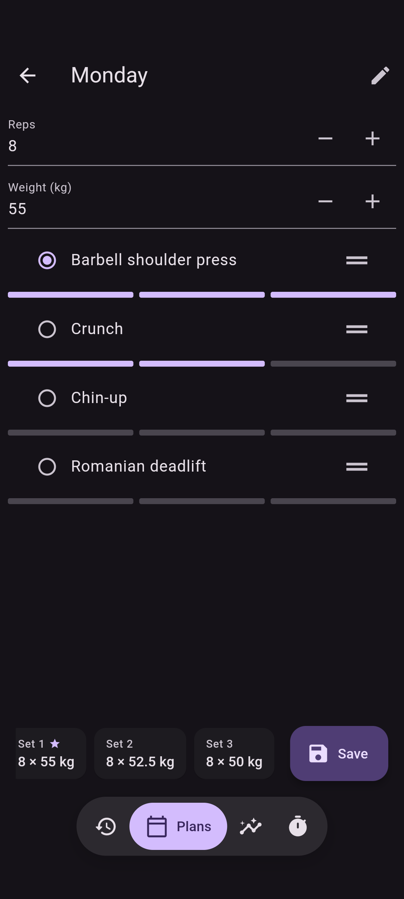
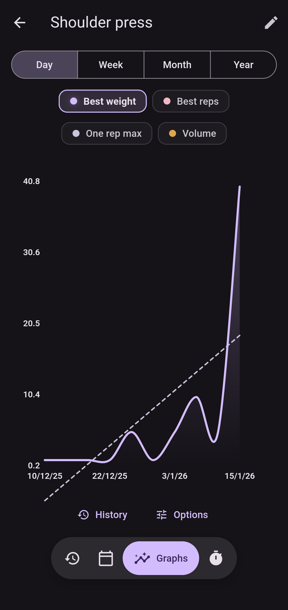
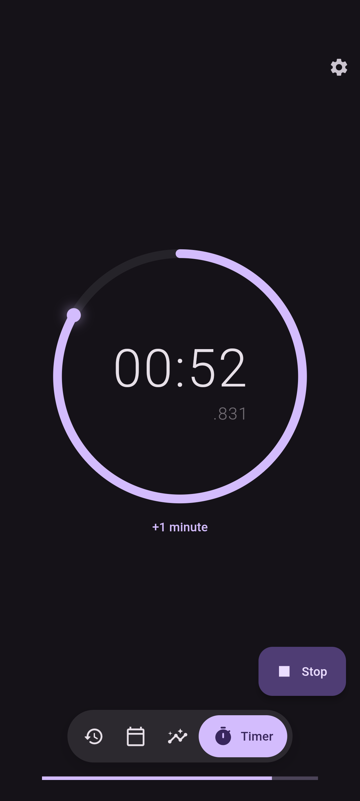
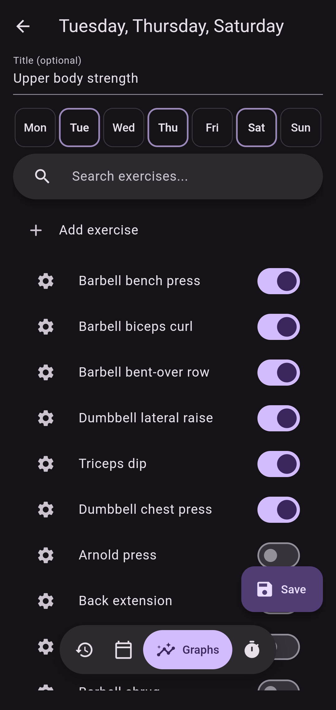
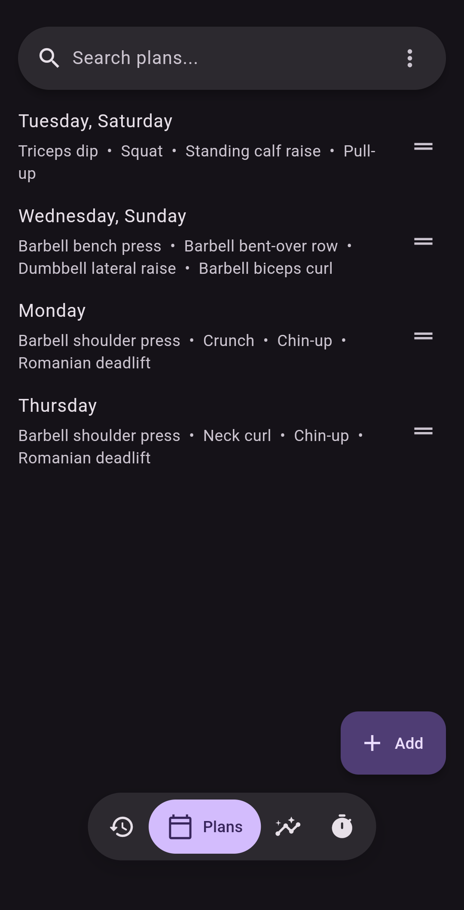
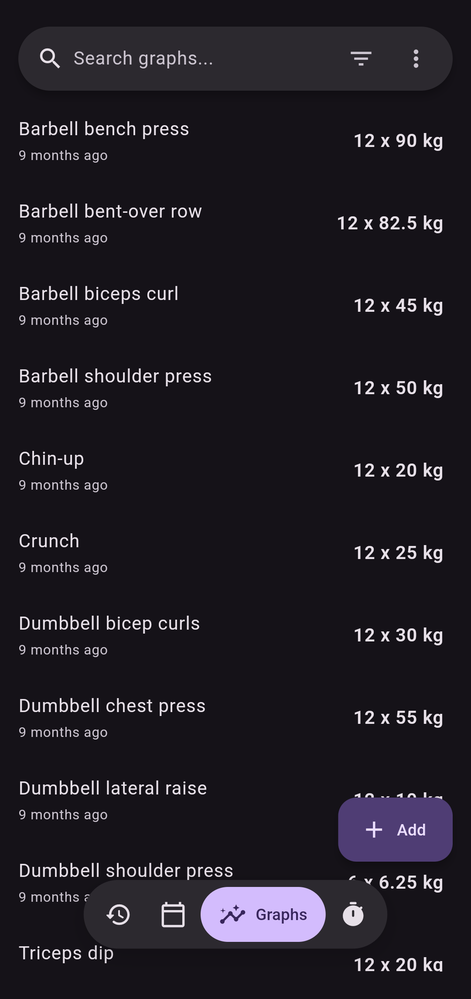
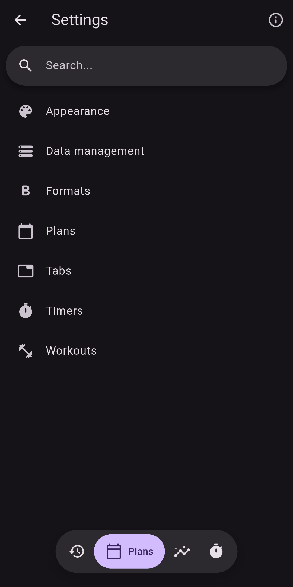
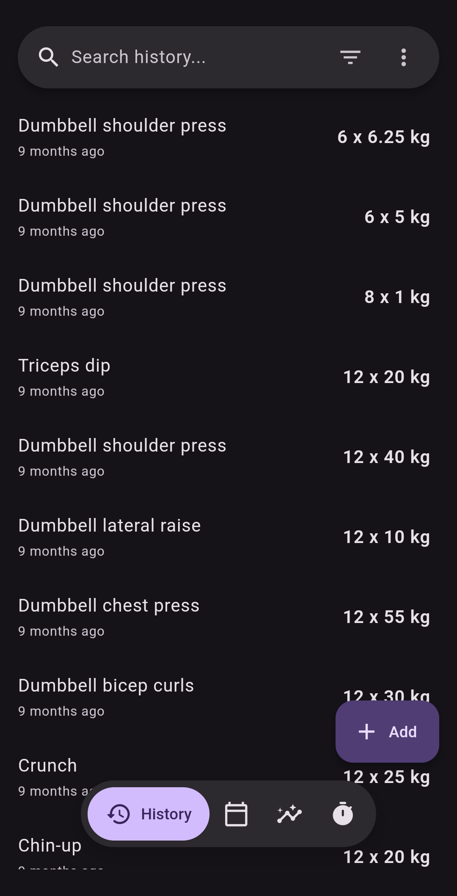

<div align="center">
  

# Flex

**Track your training. Flex on people.**

A private, offline-first workout tracker for logging gym sessions and building strength over time.

<p>
  <a href="https://f-droid.org/packages/com.presley.flexify"></a>
  <a href="https://play.google.com/store/apps/details?id=com.presley.flexify"></a>
  <a href="https://apps.microsoft.com/detail/Flex/9P13THVK7F69?mode=direct"></a>
</p>
</div>

## Train your way

- Build workout plans around the exercises and schedule that suit you
- Log weights, reps, cardio, and rest periods as you train
- Follow your progress with exercise history and graphs
- Make the app your own with configurable features and light or dark themes
- Keep your data on your device—Flex works without an internet connection

## Screenshots

<p align="center">
  
  
  
  
  
  
  
  
</p>

## Build from source

Flex is open source and built with Flutter.

```sh
flutter pub get
flutter run
```

Contributions are welcome—see [CONTRIBUTING.md](CONTRIBUTING.md). Flex is available under the [MIT License](LICENSE.md).

## Support Flex

Contributions to Flex are directly correlated with gains.

- Bitcoin: `bc1qzlte8featxzf7xvtp3rjv7qqtwkgpup8hu85gp`
- Monero (XMR): `85tmLfWKbpd8nxQnUY878DDuFjmfcoCFXPWR7XYKLHBSbDZV8wxgoKYUtHtq1kHWJg4m14sdBXhYuUSbxEDA29d19XuREL5`
- [GitHub Sponsors](https://github.com/sponsors/brandonp2412)
